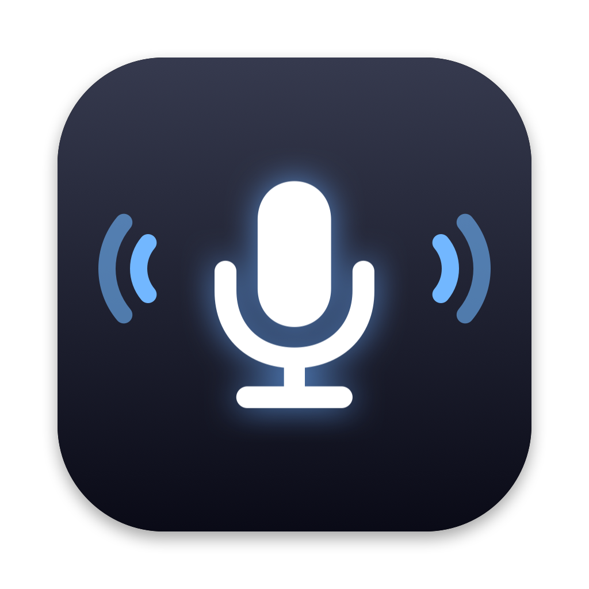

<p align="center">
  
</p>

<h1 align="center">NotchMic</h1>

<p align="center">
  <b>Tap your MacBook twice. Start talking.</b><br>
  A tiny macOS app that turns your notch and your laptop's body into a Dictation switch.
</p>

<p align="center">
  <a href="https://github.com/WallaceMcCarthy/NotchMic/releases/latest"><b>⬇ Download</b></a> ·
  <a href="https://wallacemccarthy.github.io/NotchMic/">Website</a> ·
  <a href="#how-it-works">How it works</a>
</p>

---

## What it does

- **Double-tap the laptop.** Knock twice on the body of your MacBook and macOS Dictation starts. Double-tap again and it stops. NotchMic reads the motion sensor hidden inside Apple-silicon MacBooks, so there's no new hardware.
- **Click beside the notch.** A faint mic sits just right of the camera notch. Click it to start Dictation, click again to stop.
- **Only taps down count.** NotchMic splits every jolt into its vertical and sideways parts, using gravity to tell which way is down. Sliding the laptop across a desk or bumping it from the side is ignored.
- **Ignores your typing.** Typing and clicking shake the laptop too. NotchMic throws away any bump that lands within 0.3 s of a key press or click, so writing an email won't start it.
- **Works in any app.** It presses the frontmost app's own **Edit → Start Dictation** menu item, so your words land wherever your cursor is.
- **Invisible.** No Dock icon, no menu bar clutter, no window. One 170 KB app.

## Install

1. Download `NotchMic.zip` from the [latest release](https://github.com/WallaceMcCarthy/NotchMic/releases/latest) and unzip it.
2. Drag **NotchMic.app** into your **Applications** folder.
3. Open it. NotchMic isn't notarized by Apple (that needs a paid developer account), so macOS blocks it the first time. Go to **System Settings → Privacy & Security**, scroll down, and click **Open Anyway**. Or run this once in Terminal:
   ```bash
   xattr -dr com.apple.quarantine /Applications/NotchMic.app
   ```
4. Allow **Accessibility** when asked (**System Settings → Privacy & Security → Accessibility**, switch on NotchMic). It needs this to press the Dictation menu item and to notice your typing.
5. Turn on Dictation if it's off: **System Settings → Keyboard → Dictation**.
6. Optional: add NotchMic to **System Settings → General → Login Items** so it starts with your Mac.

To quit, right-click the mic beside the notch and choose **Quit NotchMic**.

## Requirements

- An Apple-silicon MacBook running macOS 13 or later.
- The click target needs a MacBook with a notch.
- Double tap needs the built-in motion sensor. NotchMic was built and tested on a 2025 MacBook Pro. Other Apple-silicon MacBooks probably have the same sensor, but that's untested. If yours doesn't, clicking the mic still works.

## How it works

Apple-silicon MacBooks carry an accelerometer that macOS doesn't advertise. It shows up as an HID device (vendor usage page `0xFF00`, usage `3`) and streams about 800 readings a second, and an ordinary app can read it with no admin rights.

NotchMic keeps a running average of those readings and watches for sudden jolts:

1. **A jolt** is any reading more than 0.02 g from the average. At rest, jitter stays under 0.002 g. A firm tap measures 0.02 to 0.10 g.
   The average is gravity, so it marks which way is down. Each jolt is split into a vertical part and a sideways part, and it only counts as a tap when the vertical part clears 0.02 g and the sideways part is smaller. A tap on the palm rest measured about 0.04 g down and under 0.013 g sideways; a shove from the side, 0.077 g sideways and 0.003 g down.
2. **One tap rings** for a moment, so jolts within 0.1 s of each other count as the same tap.
3. **It waits 0.15 s** before deciding, then throws the jolt out if a key or click happened within 0.3 s of it. Key events can arrive after the vibration they cause, which is why it waits.
4. **Two taps 0.12 to 0.6 s apart** toggle Dictation. Further taps are ignored for 1.5 s.

Turning Dictation **on** presses the frontmost app's **Start Dictation** menu item through the Accessibility API. Pressing that item a second time doesn't stop Dictation, so turning it **off** sends the Escape key.

## Tuning

Every number above is a setting. Change it and restart the app, no rebuild needed:

```bash
defaults write local.notchmic threshold -float 0.03   # harder taps needed (g)
defaults write local.notchmic sideways -float 0.5     # stricter about sideways movement (ratio to vertical)
defaults write local.notchmic gapMax -float 0.8       # allow slower double taps (s)
defaults write local.notchmic taps -int 1             # single tap instead of double
defaults write local.notchmic cooldown -float 2       # pause after a toggle (s)
defaults write local.notchmic log -bool YES           # log taps to ~/Library/Logs/NotchMic.log
pkill NotchMic; open /Applications/NotchMic.app
```

The log records tap strengths and event types, never which keys you pressed.

## Known limits

- NotchMic tracks on and off itself, because macOS doesn't say whether Dictation is running. If Dictation stops by itself (for example after a long silence), one double tap will do nothing. Do it once more and it's back in step.
- Some apps don't have a **Start Dictation** menu item. NotchMic beeps in those.

## Build from source

You need the Xcode command-line tools (`xcode-select --install`).

```bash
git clone https://github.com/WallaceMcCarthy/NotchMic.git
cd NotchMic
./build.sh                       # builds ~/Applications/NotchMic.app
./build.sh /some/path/NotchMic.app   # or anywhere you like
```

The build signs the app with a local ad-hoc signature, which changes every build. macOS ties the Accessibility permission to that signature, so **after each rebuild, remove NotchMic from the Accessibility list and add it again**.

The icon is drawn in code: `cd icon && swift draw_variants.swift` redraws every variant.

## License

[MIT](LICENSE)
